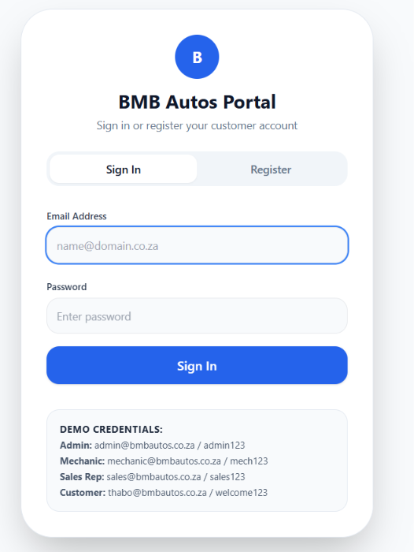
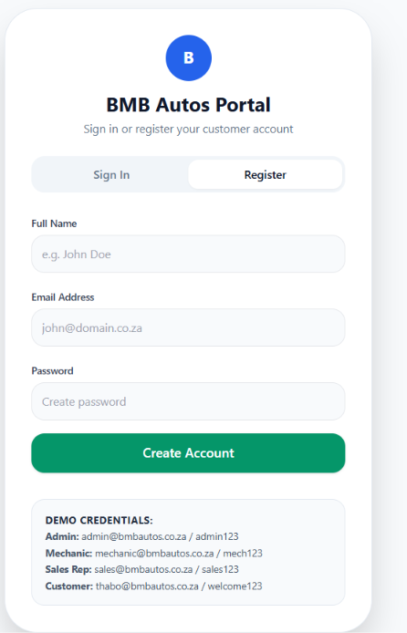
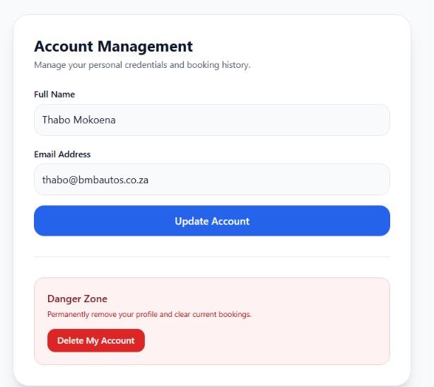
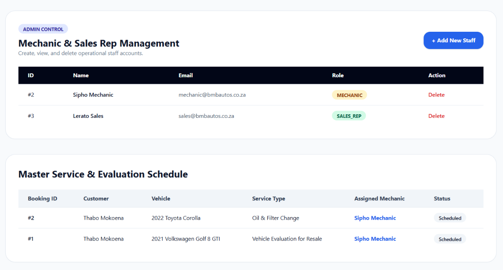
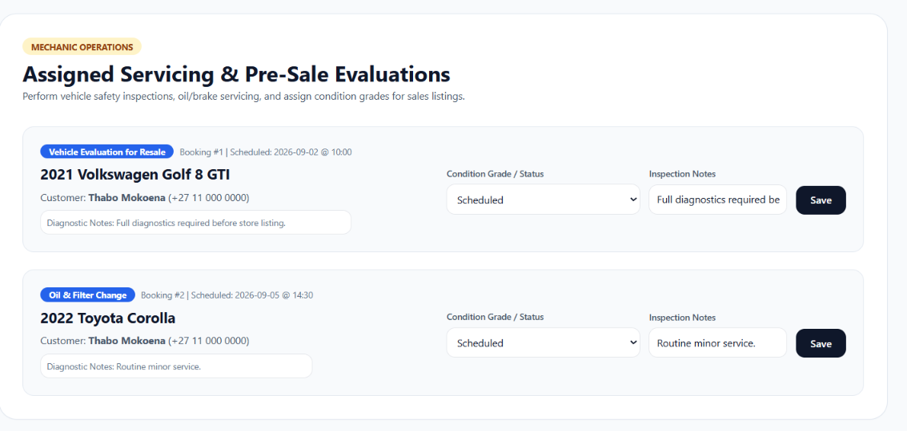
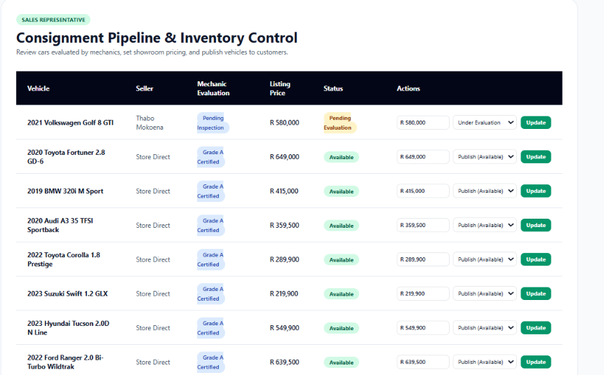
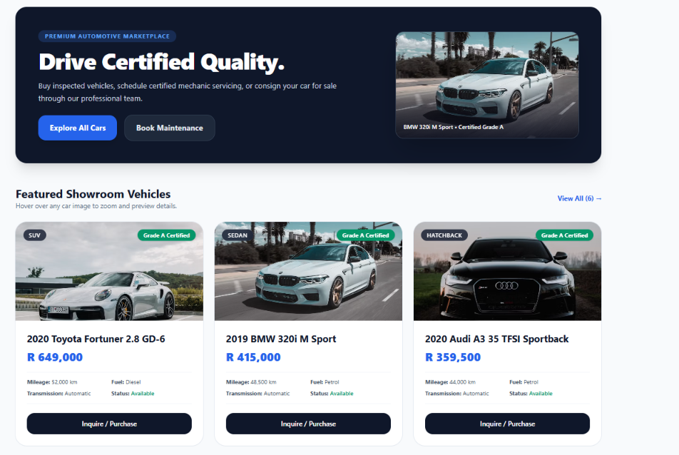
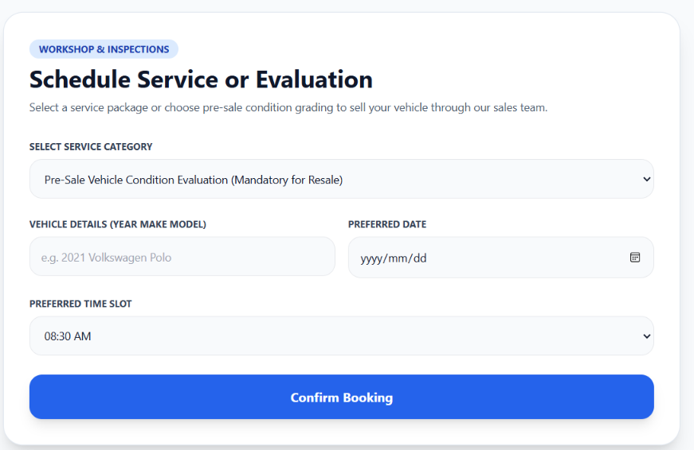
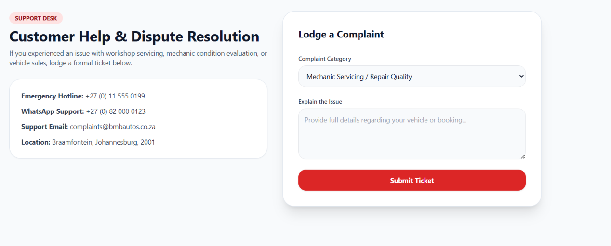

# BMB Autos

## Automotive Dealership & Servicing Platform

An end-to-end automotive web application built with **PHP**, **MySQL**, **Tailwind CSS**, and **JavaScript**. BMB Autos brings together **vehicle showroom sales**, **customer consignment**, **mechanic inspections**, and **customer support** through a unified **role-based access control (RBAC)** architecture.

---

## Visual Interface & Dashboards

### Authentication & Access

| Sign In | Customer Registration | Account Profile |
| :---: | :---: | :---: |
|  |  |  |
| *Multi-Role Credential Routing* | *New Account Creation* | *Account Management & Deletion* |

---

### Staff & Workshop Portals

| Admin Control Center | Mechanic Evaluation Deck | Sales Representative Portal |
| :---: | :---: | :---: |
|  |  |  |
| *Staff CRUD & Global Schedule* | *Vehicle Condition & Grading* | *Consignment & Inventory Publishing* |

---

### Customer Operations & Showroom

| Vehicle Showroom & Hover Zoom | Service & Evaluation Booking | Support & Dispute Resolution |
| :---: | :---: | :---: |
|  |  |  |
| *Certified Fleet & Lightbox Preview* | *Maintenance & Pre-Sale Booking* | *Categorized Incident Ticket Filing* |

---

## Key System Features

* **Interactive Vehicle Catalog:** Live car listings with hover image zoom, vehicle specs (mileage, transmission, fuel type), and full-size modal lightbox previews.
* **Customer Consignment:** Vehicle owners submit their cars directly to the dealership to be certified and sold.
* **Mechanic Inspections:** Workshop staff conduct pre-sale assessments, record technical notes, and certify roadworthiness grades (*Grade A*, *Grade B*, *Failed*).
* **Consignment Sales Pipeline:** Sales representatives adjust retail pricing on evaluated cars and publish verified inventory directly to the storefront.
* **Service Booking System:** Schedule minor services, brake overhauls, or pre-sale evaluations with assigned technicians.
* **Formal Customer Support:** Dedicated ticket filing system with tracking for service, billing, and inspection inquiries.
* **Master Administration:** Complete CRUD capabilities over staff members and central visibility across all mechanic appointments.

---

## Directory & File Structure

```text
C:\wamp64\www\BMB_AUTOS\
├── images/             # Vehicle photography, branding, and vector logo
│   ├── logo.svg        # Scalable automotive emblem
│   └── ...             # Showroom vehicle imagery
├── screenshots/        # Application interface previews for documentation
├── about.php           # Company mission and business background
├── admin.php           # Admin control panel (Staff CRUD & master schedule)
├── cars.php            # Vehicle showroom with lightbox preview & consignment modal
├── db.php              # Global PDO database connection handler
├── index.php           # Dynamic homepage with active bookings & featured fleet
├── login.php           # Dual-action sign in and registration portal
├── logout.php          # Session termination script
├── mechanic.php        # Mechanic workshop workbench & evaluation management
├── nav.php             # Role-based adaptive navigation header
├── process.php         # Centralized AJAX/Form API endpoint
├── profile.php         # Customer account editing and account deletion
├── sales.php           # Sales rep consignment and inventory publishing
├── script.js           # Asynchronous form handlers & toast notification system
├── servicing.php       # Service & maintenance booking interface
├── setup_db.php        # 1-Click automated database installer & data seeder
└── support.php         # Customer dispute resolution & complaint filing
```

## Setup & Execution Guide

### Prerequisites

- **WampServer** (or XAMPP) on Windows.
- Confirm that both **Apache** and **MySQL** services are active. The WAMP icon in the Windows taskbar should be solid green.

### Installation Steps

1. **Verify the project location**

	Confirm that the project directory is located at:

	```text
	C:\wamp64\www\BMB_AUTOS\
	```

2. **Initialize the database**

	Open the following URL in your browser:

	<http://localhost/BMB_AUTOS/setup_db.php>

	This creates the **bmb_autos** MySQL database, applies the relational schema, and seeds the initial inventory and user accounts.

3. **Launch the platform**

	Navigate to the live prototype:

	<http://localhost/BMB_AUTOS/index.php>

## Demo Login Credentials

| Role | Email Address | Password | Permissions |
| :--- | :--- | :--- | :--- |
| **Administrator** | `admin@bmbautos.co.za` | `admin123` | Staff CRUD, master schedule, support audit |
| **Mechanic** | `mechanic@bmbautos.co.za` | `mech123` | Evaluation deck, service status updates |
| **Sales Rep** | `sales@bmbautos.co.za` | `sales123` | Consignment review, inventory publishing |
| **Customer** | `thabo@bmbautos.co.za` | `welcome123` | Car buying/selling, bookings, support tickets |