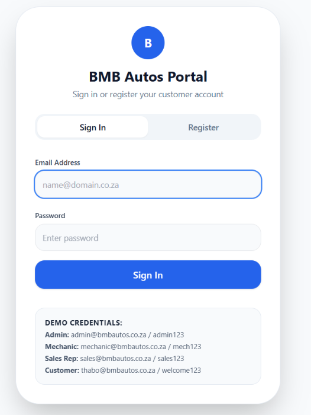
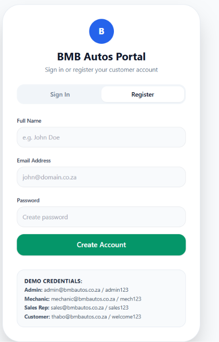
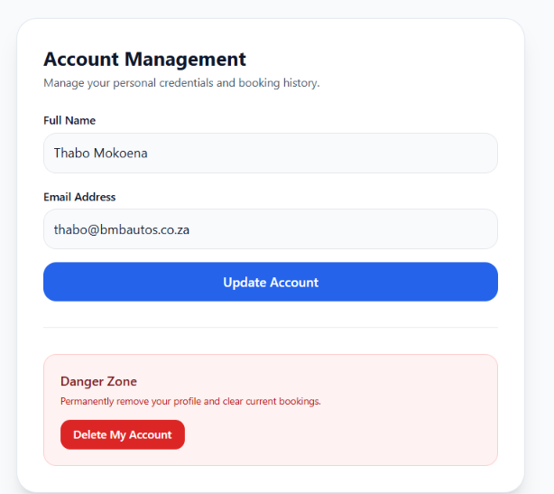
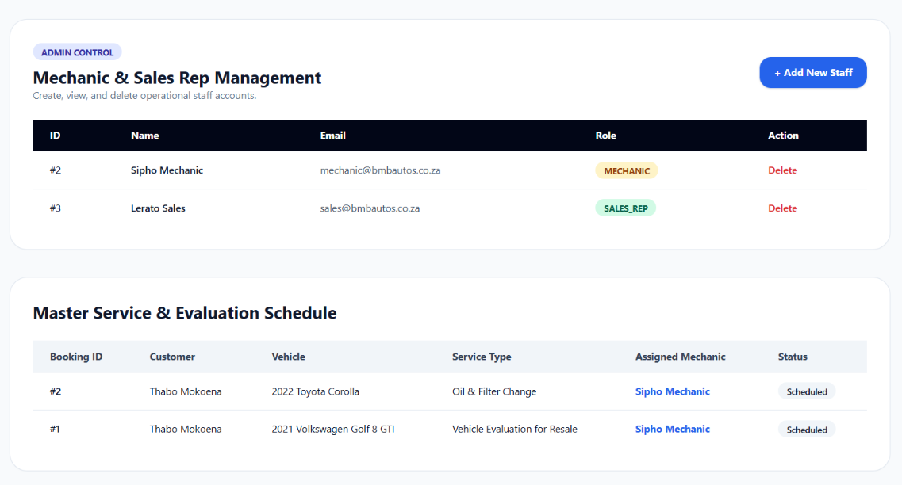
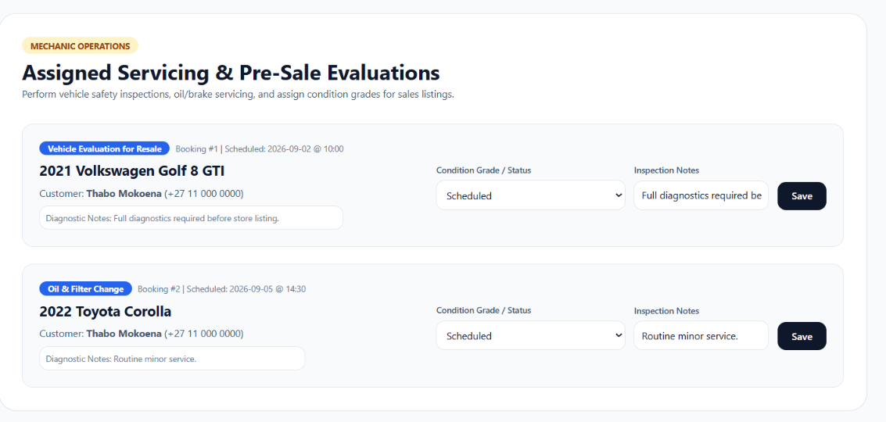
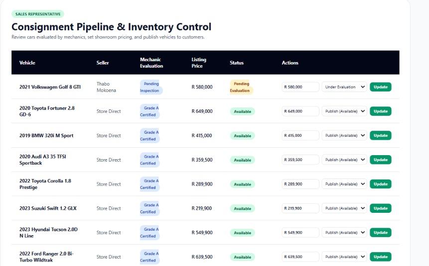
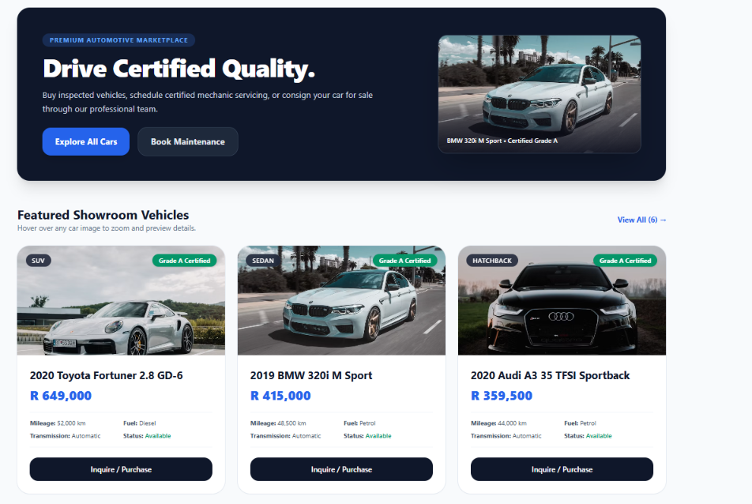
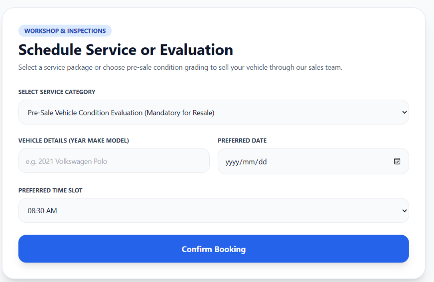
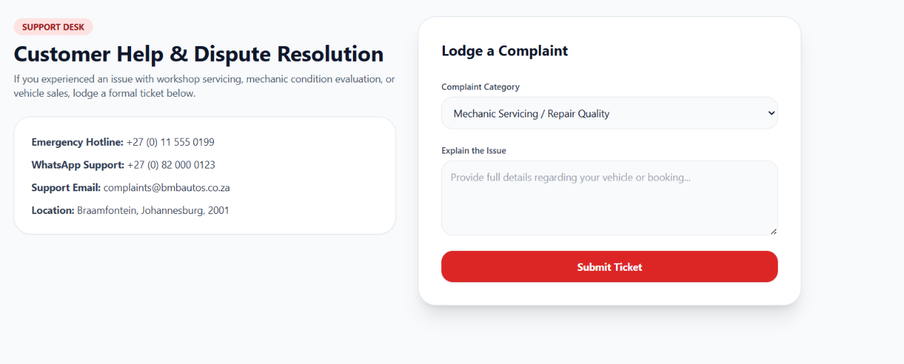

# BMB Autos

## Automotive Dealership & Servicing Platform

An end-to-end automotive web application built with **PHP**, **MySQL**, **Tailwind CSS**, and **JavaScript**. BMB Autos brings together **vehicle showroom sales**, **customer consignment**, **mechanic inspections**, and **customer support** through a unified **role-based access control (RBAC)** architecture.

---

## Visual Interface & Dashboards

### Authentication & Access

| Sign In | Customer Registration | Account Profile |
| :---: | :---: | :---: |
|  |  |  |
| *Multi-Role Credential Routing* | *New Account Creation* | *Account Management & Deletion* |

---

### Staff & Workshop Portals

| Admin Control Center | Mechanic Evaluation Deck | Sales Representative Portal |
| :---: | :---: | :---: |
|  |  |  |
| *Staff CRUD & Global Schedule* | *Vehicle Condition & Grading* | *Consignment & Inventory Publishing* |

---

### Customer Operations & Showroom

| Vehicle Showroom & Hover Zoom | Service & Evaluation Booking | Support & Dispute Resolution |
| :---: | :---: | :---: |
|  |  |  |
| *Certified Fleet & Lightbox Preview* | *Maintenance & Pre-Sale Booking* | *Categorized Incident Ticket Filing* |

---

## Key System Features

* **Interactive Vehicle Catalog:** Live car listings with hover image zoom, vehicle specs (mileage, transmission, fuel type), stock counts, and full-size modal lightbox previews.
* **Inventory Stock Control:** Every vehicle includes `stock_quantity`, with admin controls to increase/decrease stock and automatically mark cars as `Sold` when stock hits zero.
* **Purchase & Receipt Flow:** Customers can buy a vehicle from the showroom, receive a transaction record, and land on a printable receipt page using `receipt.php?transaction_id=...`.
* **Customer Consignment:** Vehicle owners submit their cars directly to the dealership to be certified and sold.
* **Mechanic Inspections:** Workshop staff conduct pre-sale assessments, record technical notes, and certify roadworthiness grades (*Grade A*, *Grade B*, *Failed*).
* **Consignment Sales Pipeline:** Sales representatives adjust retail pricing on evaluated cars and publish verified inventory directly to the storefront.
* **Service Booking System:** Schedule minor services, brake overhauls, or pre-sale evaluations with assigned technicians.
* **Formal Customer Support:** Dedicated ticket filing system with tracking for service, billing, and inspection inquiries.
* **Master Administration:** Complete CRUD capabilities over staff members and central visibility across all mechanic appointments.
* **Mobile-Ready UI:** The site has been optimized for tablet and phone layouts with responsive navigation, stacked forms, touch-friendly buttons, and viewport-aware scaling.
* **Mobile App JSON API:** The backend exposes REST-style JSON endpoints for an Android application built with Kotlin and Retrofit.
* **Token Authentication:** Mobile clients authenticate using Bearer tokens instead of traditional PHP sessions, enabling secure app-to-server communication.

## Mobile Ready & Responsive Design

The BMB Autos storefront and admin interfaces are now built to work comfortably on mobile devices, not just desktop screens.

Highlights include:

* responsive hamburger navigation for smaller screens
* stacked layouts for forms, cards, and tables on phone widths
* larger touch-friendly controls for CTAs and filters
* viewport-aware scaling across all main pages
* showroom search and filter controls that remain usable on mobile devices
* printable receipt layouts suitable for mobile and desktop viewing

## Purchase Flow & Transaction Handling

The vehicle purchase workflow now enforces inventory safety checks:

1. A customer selects a vehicle from the showroom.
2. The backend checks the current available stock and rejects purchase if stock is zero or the vehicle is already marked sold.
3. The vehicle stock is decremented by 1.
4. If stock reaches zero, the vehicle status is updated to `Sold`.
5. A `transactions` record is created and a redirect is sent to `receipt.php?transaction_id=...`.
6. The customer receives a printable receipt for the order.

This logic is enforced in the website flow and in the API purchase endpoint.

## Mobile App & REST API Integration

BMB Autos now includes a dedicated REST API layer under the `api/` folder so that a mobile application can communicate with the dealership platform without using the browser UI. The backend serves JSON responses for app screens such as login, vehicle listings, vehicle details, bookings, profile updates, and trade-in requests.

This integration supports the Android app being developed in Kotlin with Retrofit, while still preserving the original PHP web experience for desktop and browser users. The API is designed to work with secure token-based access, allowing mobile users to authenticate once and include the returned bearer token in subsequent requests.

The database has also been extended for app support, including new `users` fields such as `api_token`, `google_id`, `notify_email`, and `notify_push`, together with a `transactions` table used for mobile purchase tracking and app-related payment flows.

## Directory & File Structure

```text
C:\wamp64\www\BMB_AUTOS\
├── api/                 # REST API layer for mobile app JSON integration
│   ├── config.php       # API configuration, DB connection, and shared settings
│   ├── auth_check.php   # Bearer token validation middleware for protected routes
│   ├── register.php     # Mobile user registration endpoint
│   ├── login.php        # Login endpoint returning access tokens
│   ├── cars.php         # Vehicle listing endpoint for app catalog screens
│   ├── car_details.php  # Individual vehicle detail endpoint
│   ├── bookings.php     # Service and booking management endpoints
│   ├── purchase_car.php # Vehicle purchase endpoint with stock validation
│   ├── trade_in.php     # Trade-in submission and processing endpoint
│   ├── update_profile.php # User profile update endpoint for mobile clients
├── images/              # Vehicle photography, branding, and vector logo
│   ├── logo.svg         # Scalable automotive emblem
│   └── ...              # Showroom vehicle imagery
├── screenshots/         # Application interface previews for documentation
├── about.php            # Company mission and business background
├── admin.php            # Admin control panel (Staff CRUD & master schedule)
├── cars.php             # Vehicle showroom with lightbox preview, filters, and purchase flow
├── db.php               # Global PDO database connection handler
├── index.php            # Dynamic homepage with active bookings & featured fleet
├── login.php            # Dual-action sign in and registration portal
├── logout.php           # Session termination script
├── mechanic.php         # Mechanic workshop workbench & evaluation management
├── nav.php              # Role-based adaptive navigation header
├── process.php          # Centralized AJAX/Form API endpoint
├── profile.php          # Customer account editing and account deletion
├── receipt.php          # Printable purchase receipt page for completed orders
├── sales.php            # Sales rep consignment and inventory publishing
├── script.js            # Asynchronous form handlers & toast notification system
├── servicing.php        # Service & maintenance booking interface
├── setup_db.php         # 1-Click automated database installer & data seeder
├── support.php          # Customer dispute resolution & complaint filing
└── README.md            # Project overview and documentation
```

## Setup & Execution Guide

### Prerequisites

- **WampServer** (or XAMPP) on Windows.
- Confirm that both **Apache** and **MySQL** services are active. The WAMP icon in the Windows taskbar should be solid green.

### Installation Steps

1. **Verify the project location**

	Confirm that the project directory is located at:

	```text
	C:\wamp64\www\BMB_AUTOS\
	```

2. **Initialize the database**

	Open the following URL in your browser:

	<http://localhost/BMB_AUTOS/setup_db.php>

	This creates the **bmb_autos** MySQL database, applies the relational schema, and seeds the initial inventory and user accounts.

3. **Launch the platform**

	Navigate to the live prototype:

	<http://localhost/BMB_AUTOS/index.php>

4. **Test the purchase flow**

	Log in as a customer, open the showroom, purchase a vehicle, and confirm the receipt page loads with a valid `transaction_id`.

## Demo Login Credentials

| Role | Email Address | Password | Permissions |
| :--- | :--- | :--- | :--- |
| **Administrator** | `admin@bmbautos.co.za` | `admin123` | Staff CRUD, master schedule, support audit |
| **Mechanic** | `mechanic@bmbautos.co.za` | `mech123` | Evaluation deck, service status updates |
| **Sales Rep** | `sales@bmbautos.co.za` | `sales123` | Consignment review, inventory publishing |
| **Customer** | `thabo@bmbautos.co.za` | `welcome123` | Car buying/selling, bookings, support tickets |